<picture>
  <source media="(prefers-color-scheme: dark)" srcset="assets/header-dark.svg">
  <source media="(prefers-color-scheme: light)" srcset="assets/header-light.svg">
  
</picture>

  
  
  

---

<h3 align="center">🧑‍💻 About me</h3>

  🎓 <b>Computer Engineering</b> student at <b>UFSC</b> (Federal University of Santa Catarina) 
  ⚡ Focused on <b>embedded systems</b>: bare-metal firmware, real-time control and hardware–software integration 
  🔌 Member of <b>ProtoFPGA</b>, a hardware league where we design, build and simulate digital hardware 
  🛰️ Curious about <b>aerospace</b> and <b>safety-critical systems</b>

---

<h3 align="center">🛠️ Tech stack</h3>

  <code>EMBEDDED &amp; HARDWARE</code>
    
  
  
  
  
  

  <code>SOFTWARE</code>
    
  
  
  
  

  <code>TOOLS</code>
    
  
  
  

